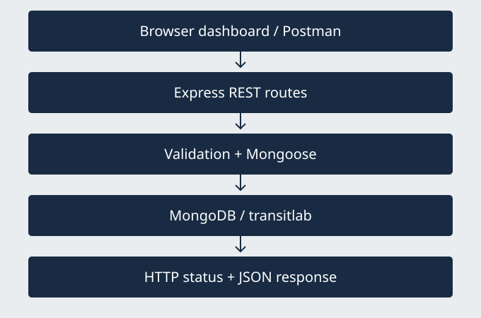

# Transit / API Studio — Experiment 07
**Khushi Jain Daga | 23bcon1665 | Web Development Using AI | Semester VII**

## Aim
Develop RESTful APIs for a web application and test them using Postman with AI-generated API documentation.

## Project
A fictional transport route catalogue, with an interactive frontend, live HTTP inspector, Express API and MongoDB persistence. No real transit data, authentication or production deployment is implied. Keep the unauthenticated write API local.

## Architecture

## Tools
Node.js, Express, Mongoose, MongoDB, HTML5, CSS3, vanilla JavaScript, Fetch API, OpenAPI 3.0.3, Swagger UI, Postman, ChatGPT.

## Setup
Run `npm install`. Copy `.env.example` to `.env` and replace the local URI with your working Atlas URI if applicable. The backend explicitly selects `transitlab`. Keep `.env` private. Run `npm start` and open http://localhost:8006. Swagger UI: http://localhost:8006/api-docs. Raw specification: `/api/openapi.json`.

## API contract
| Method | Path | Success |
|---|---|---|
| GET | /api/health | 200 |
| GET | /api/routes | 200 |
| GET | /api/routes/:id | 200 |
| POST | /api/routes | 201 |
| PUT | /api/routes/:id | 200 |
| PATCH | /api/routes/:id | 200 |
| DELETE | /api/routes/:id | 204 |

List supports search, mode, active, page and limit. Required fields: code, origin, destination, mode (Bus/Metro/Rail), fare (nonnegative number), duration (positive integer minutes), active (boolean). Code is normalized to uppercase and unique. PUT requires all fields; PATCH accepts a nonempty subset. Invalid input returns 400, unknown IDs 404, duplicates 409, unexpected errors 500.

## Procedure
1. Define route schema and REST contract.
2. Implement Express routing, input validation and MongoDB persistence.
3. Connect the dashboard and request inspector using Fetch.
4. Generate OpenAPI specification and serve Swagger UI.
5. Import the Postman collection and environment; run requests in order. The create request generates a unique code and saves its ID. The collection deletes its demo record.
6. Capture genuine browser and Postman runner output.

## AI development brief
Create an original transport route management REST API with Express and MongoDB. Implement CRUD, partial updates, search, pagination, meaningful status codes, validation, Swagger documentation, a Postman collection with assertions and an interactive HTML/CSS/JS client. Highlight the student identity.

## Verification
Run `npm test` for four pure validation tests. Syntax and validation checks passed during packaging. Live MongoDB integration, Swagger browser rendering, Postman execution and responsive browser checks remain pending on the student's machine. The Postman collection contains eleven requests with status assertions; these are expected results, not recorded test outcomes.

## Conclusion
The source demonstrates REST resource operations, documented contracts and independent API testing surfaces. Confirm live results before academic submission.
